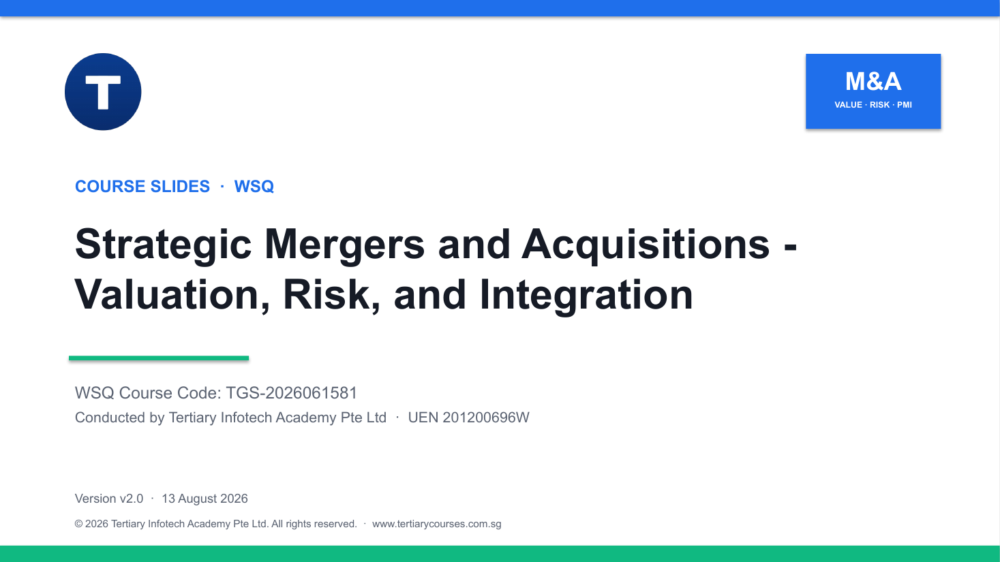

# Strategic Mergers and Acquisitions — Valuation, Risk, and Integration

A two-day WSQ course on managing the full M&A lifecycle — deal structuring and valuation, financial and tax impact, target screening and risk, and post-merger integration — built around one progressive real-world case.

| Course detail | Information |
|---|---|
| Course code | `TGS-2026061581` |
| Programme | WSQ |
| Skills Framework | TSC `WST-CFI-5003-1.1-1` — Mergers and Acquisition |
| Duration | 2 days (16 hours, including a 2-hour assessment) |
| Registration | [View course details and register](https://www.tertiarycourses.com.sg/wsq-strategic-mergers-and-acquisitions-valuation-risk-and-integration.html) |
| Funding | Up to 70% WSQ course fee funding for eligible learners. Eligibility and terms apply — see the course page. |



## About the course

The course equips finance professionals, business strategists and corporate decision-makers with the knowledge and tools to manage mergers and acquisitions. Learners work with financial instruments, business valuation methods and deal structures, forecast the financial and tax impact of a transaction, screen targets with industry intelligence, run risk assessments and due diligence, and plan stakeholder engagement, governance and cultural integration for post-merger execution.

## Learning outcomes

By the end of the course, learners should be able to:

1. **LO1** — Apply financial instruments and valuation methods to structure mergers and acquisitions that optimise organisational benefit and shareholder value.
2. **LO2** — Evaluate the business, financial and tax impact of potential M&A deals using industry data and forecasting techniques.
3. **LO3** — Identify, assess and manage M&A risks across the full transaction lifecycle, from target selection to post-deal integration.
4. **LO4** — Collaborate with stakeholders to develop and implement M&A plans while ensuring governance, synergy realisation and strategic alignment.

## Topics covered

1. **Deal Structuring and Valuation Principles** — financial instruments, valuation, shareholder value, economies of scale
2. **Forecasting, Financial and Tax Implications** — business impact, synergies, pro forma statements, tax
3. **Target Identification, Risk and Intelligence** — industry intelligence, screening, due diligence, risk, business intelligence
4. **Stakeholder Alignment and Post-Merger Integration** — governance, checks and balances, integration management office, culture, change

## Activities

All eight activities use the announced Bonadio Group–T. Gschwender & Associates (TGA) transaction. Reported facts are kept separate from course-only financial assumptions, because the public announcement did not disclose transaction terms. See the [activities index](activities/README.md).

1. [Deal Thesis and Structure](activities/activity-01-bonadio-tga-deal-thesis-and-structure-activity/README.md)
2. [Valuation Triangulation](activities/activity-02-bonadio-tga-valuation-triangulation-activity/README.md)
3. [Three-Year Synergy Forecast](activities/activity-03-bonadio-tga-three-year-synergy-forecast-activity/README.md)
4. [Pro Forma and Tax Challenge](activities/activity-04-bonadio-tga-pro-forma-and-tax-challenge-activity/README.md)
5. [Target Screening and Diligence](activities/activity-05-bonadio-tga-target-screening-and-diligence-activity/README.md)
6. [M&A Risk Intelligence](activities/activity-06-bonadio-tga-m-a-risk-intelligence-activity/README.md)
7. [Integration Program Design](activities/activity-07-bonadio-tga-integration-program-design-activity/README.md)
8. [Culture, Talent and Client Continuity](activities/activity-08-bonadio-tga-culture-talent-and-client-continuity-activity/README.md)

## Public package contents

| Item | Files |
|---|---|
| Slide deck (v2.0) | [PPTX](courseware/Strategic%20Mergers%20and%20Acquisitions-v2.0.pptx) · [PDF](courseware/Strategic%20Mergers%20and%20Acquisitions-v2.0.pdf) |
| Learner Guide | [DOCX](courseware/LG-Strategic%20Mergers%20and%20Acquisitions.docx) · [PDF](courseware/LG-Strategic%20Mergers%20and%20Acquisitions.pdf) |
| Lesson Plan | [DOCX](courseware/LP-Strategic%20Mergers%20and%20Acquisitions.docx) · [PDF](courseware/LP-Strategic%20Mergers%20and%20Acquisitions.pdf) |
| Activities | [activities/](activities/README.md) — eight activity packs, one folder each |
| Build modules | [build/](build/README.md) — single-source generators for the deck, LG and LP |

The deck reuses 36 selected diagrams and visual assets from the supplied original presentation. Detailed procedures live in the Learner Guide and the activity files rather than in the slides.

To rebuild the courseware:

```bash
./build/build_courseware.sh
```

## Distribution boundary

This repository publishes the learner-facing courseware only. The `assessment/` folder (Written Assessment and Case Study question papers and trainer-only answer keys), the `reference/` source material, research notes and credentials are deliberately excluded and are never pushed.

## Principal sources

- [Bonadio–TGA transaction report](https://www.cpapracticeadvisor.com/2026/08/06/credit-risk-management-firm-joins-the-bonadio-group/188098/)
- [Trends and Risks in M&A: A Review](https://www.mdpi.com/2227-9091/12/9/143)
- [M&A in the professional services sector](https://www.financierworldwide.com/briefing-room-ma-in-the-professional-services-sector)
- [EY: Nine key steps to setting up an M&A integration program](https://www.ey.com/content/dam/ey-unified-site/ey-com/en-gl/insights/mergers-acquisitions/documents/ey-nine-key-steps-to-setting-up-merger-acquisition-integration-program.pdf)
- [Risk Management in Enterprise M&A](https://papers.ssrn.com/sol3/papers.cfm?abstract_id=5106493)

## Provider

Developed and delivered by [Tertiary Infotech Academy Pte Ltd](https://www.tertiarycourses.com.sg/) (UEN 201200696W).
